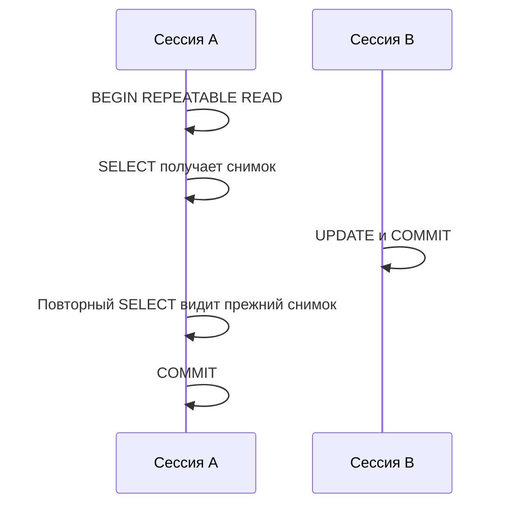

# PostgreSQL: от SQL до внутреннего устройства

Практический курс на русском для разработчиков, аналитиков и инженеров, которым важно понимать не только синтаксис запросов, но и поведение базы под нагрузкой. Вы построите учебный сервис заказов, исследуете планы запросов, воспроизведёте блокировки и разберёте MVCC, WAL и vacuum.

**Формат:** короткая теория → воспроизводимый пример → задание → проверка. Материалы рассчитаны на PostgreSQL 16; детали и планы могут отличаться в других версиях, на другом оборудовании и при других данных. Выполняйте практику только в отдельной учебной базе, без реальных данных.

> Продолжение: [продвинутые лабораторные и инциденты](ADVANCED.md) - планы запросов, индексы, конкурентный доступ, deadlock и VACUUM.

## Содержание

| Модуль | Результат |
|---|---|
| [0. Запуск](#0-запуск-и-учебная-схема) | Локальная база и данные |
| [1. Основы SQL](#1-основы-sql-и-null) | Фильтрация, NULL и агрегации |
| [2. JOIN и подзапросы](#2-join-и-подзапросы) | Соединения без размножения строк |
| [3. Оконные функции](#3-оконные-функции) | Рейтинги и накопительные суммы |
| [4. Модель данных](#4-модель-данных-и-ограничения) | Ключи, ограничения и миграции |
| [5. Индексы](#5-индексы) | Составные, частичные и покрывающие индексы |
| [6. EXPLAIN](#6-планы-запросов) | Чтение планов и диагностика оценок |
| [7. Транзакции и MVCC](#7-транзакции-и-mvcc) | Снимки и уровни изоляции |
| [8. Блокировки](#8-блокировки-и-взаимные-блокировки) | Ожидания и deadlock |
| [9. Внутреннее устройство](#9-хранение-vacuum-и-wal) | Версии строк, vacuum, WAL и checkpoint |
| [10. JSONB и поиск](#10-jsonb-и-поиск) | Индексация и ограничения полуструктурированных данных |
| [11. Эксплуатация](#11-наблюдаемость-и-восстановление) | Метрики, резервирование и восстановление |
| [12. Итоговый проект](#12-итоговый-проект) | Проектирование и исследование сервиса |

## 0. Запуск и учебная схема

Нужны Docker с Compose и свободный локальный порт 55432. Создайте отдельную папку и файл `compose.yaml`:

```yaml
services:
  db:
    image: postgres:16
    environment:
      POSTGRES_DB: shop
      POSTGRES_USER: student
      POSTGRES_PASSWORD: local-only-password
    ports:
      - "127.0.0.1:55432:5432"
    volumes:
      - pgdata:/var/lib/postgresql/data
    healthcheck:
      test: ["CMD-SHELL", "pg_isready -U student -d shop"]
      interval: 5s
      timeout: 3s
      retries: 12
volumes:
  pgdata:
```

Пароль предназначен только для изолированной учебной среды. Не открывайте этот экземпляр в интернет и не используйте его для production. Тег образа может обновляться; для воспроизводимого production фиксируют версию и digest, затем планово обновляют образ.

```bash
docker compose up -d
docker compose ps
docker compose exec db psql -U student -d shop
```

Дождитесь состояния healthy. В `psql` включите остановку при ошибках: `\set ON_ERROR_STOP on`. Команда `\q` завершает сессию. Справка: `\?`, список таблиц: `\dt`, описание таблицы: `\d orders` после создания схемы.

Создайте таблицы и данные в psql:

```sql
CREATE TABLE customers (
    id bigint GENERATED ALWAYS AS IDENTITY PRIMARY KEY,
    email text NOT NULL UNIQUE,
    city text,
    created_at timestamptz NOT NULL DEFAULT now()
);
CREATE TABLE orders (
    id bigint GENERATED ALWAYS AS IDENTITY PRIMARY KEY,
    customer_id bigint NOT NULL REFERENCES customers(id),
    status text NOT NULL CHECK (status IN ('new', 'paid', 'cancelled')),
    total numeric(12,2) NOT NULL CHECK (total >= 0),
    created_at timestamptz NOT NULL DEFAULT now(),
    metadata jsonb NOT NULL DEFAULT '{}'::jsonb
);
CREATE TABLE order_items (
    id bigint GENERATED ALWAYS AS IDENTITY PRIMARY KEY,
    order_id bigint NOT NULL REFERENCES orders(id),
    product text NOT NULL,
    quantity integer NOT NULL CHECK (quantity > 0),
    unit_price numeric(12,2) NOT NULL CHECK (unit_price >= 0)
);
INSERT INTO customers (email, city) VALUES
    ('anna@example.test', 'Москва'),
    ('boris@example.test', 'Казань'),
    ('vika@example.test', NULL),
    ('denis@example.test', 'Москва');
INSERT INTO orders (customer_id, status, total, created_at, metadata) VALUES
    (1, 'paid', 1200, '2026-01-10 10:00+00', '{"source":"web"}'),
    (1, 'paid', 800,  '2026-01-11 10:00+00', '{"source":"app"}'),
    (2, 'new',  500,  '2026-01-11 10:00+00', '{"source":"web"}'),
    (2, 'cancelled', 300, '2026-01-12 10:00+00', '{}'),
    (3, 'paid', 2000, '2026-01-13 10:00+00', '{"source":"web"}');
INSERT INTO order_items (order_id, product, quantity, unit_price) VALUES
    (1, 'Книга', 2, 400), (1, 'Кабель', 1, 400),
    (2, 'Книга', 1, 800), (3, 'Мышь', 1, 500),
    (4, 'Кабель', 1, 300), (5, 'Клавиатура', 1, 2000);
```

**Проверка:** `SELECT count(*) FROM customers;` вернёт 4, для orders - 5, для order_items - 6. Идентификаторы выше предполагают чистую схему; не запускайте INSERT повторно. Остановить учебную базу: `docker compose down`. Добавление `-v` удалит учебный том и данные без возможности восстановления: используйте только после завершения курса.

## 1. Основы SQL и NULL

`WHERE` отбирает строки до группировки, `HAVING` - группы после неё. `NULL` означает неизвестное или отсутствующее значение, поэтому `city = NULL` не возвращает true. Для проверки используйте `IS NULL`. `count(*)` считает строки, `count(city)` - непустые значения.

```sql
SELECT city, count(*) AS customers, count(city) AS known_city
FROM customers
GROUP BY city
ORDER BY customers DESC, city NULLS LAST;

SELECT status, count(*) AS orders, sum(total) AS revenue
FROM orders
GROUP BY status
HAVING count(*) >= 2
ORDER BY status;
```

**Практика:** найдите оплаченные заказы за январь 2026 года. Используйте полуоткрытый интервал `created_at >= '2026-01-01 00:00+00' AND created_at < '2026-02-01 00:00+00'`. **Проверка:** три заказа, сумма 4000. Такой интервал не зависит от числа дней в месяце и не теряет дробные секунды.

**Подвох:** `NOT IN` с NULL в результате подзапроса может не вернуть ожидаемые строки из-за трёхзначной логики. Для поиска отсутствующих связанных строк часто удобнее `NOT EXISTS`.

## 2. JOIN и подзапросы

`LEFT JOIN` сохраняет строку слева при отсутствии совпадения, дополняя столбцы справа NULL. Условие на правую таблицу в `WHERE` может отбросить эти строки. Несколько элементов заказа умножают строку заказа при соединении: сумма `orders.total` после JOIN с items может стать завышенной.

```sql
SELECT c.id, c.email, count(o.id) AS paid_orders
FROM customers c
LEFT JOIN orders o ON o.customer_id = c.id AND o.status = 'paid'
GROUP BY c.id, c.email
ORDER BY c.id;

SELECT c.email
FROM customers c
WHERE NOT EXISTS (
    SELECT 1 FROM orders o WHERE o.customer_id = c.id
)
ORDER BY c.email;
```

**Проверка:** в первом запросе все четыре клиента, включая Дениса с нулём; во втором - только `denis@example.test`. Если перенести фильтр `o.status = 'paid'` в WHERE, клиенты без оплаченных заказов исчезнут.

**Задача:** получите число заказов и общую выручку по каждому клиенту, включая клиентов без заказов. Сначала агрегируйте orders отдельно или не соединяйте order_items; используйте `COALESCE` для отсутствующей суммы. Проверьте, что Анна имеет 2 заказа и 2000.

## 3. Оконные функции

Оконная функция вычисляется по набору строк, но не сворачивает их как GROUP BY. `row_number` присваивает уникальные номера, `rank` допускает одинаковые места и пропуски; для стабильного результата задайте порядок с разрешением равенств.

```sql
SELECT customer_id, id, created_at, total,
       row_number() OVER (
           PARTITION BY customer_id ORDER BY created_at DESC, id DESC
       ) AS rn,
       sum(total) OVER (
           PARTITION BY customer_id ORDER BY created_at, id
           ROWS BETWEEN UNBOUNDED PRECEDING AND CURRENT ROW
       ) AS running_total
FROM orders
WHERE status = 'paid'
ORDER BY customer_id, created_at, id;
```

**Практика:** с помощью CTE и `row_number()` найдите последний оплаченный заказ каждого клиента. **Проверка:** три строки; для клиента 1 выбран заказ 2. Явная рамка ROWS делает накопление построчным; при равных значениях ORDER BY рамка по умолчанию может включать peers.

## 4. Модель данных и ограничения

Первичный ключ идентифицирует строку, внешний ключ защищает ссылочную целостность, UNIQUE ограничивает дубликаты, CHECK проверяет условие. CHECK не заменяет NOT NULL: выражение с результатом unknown не нарушает CHECK. Внешний ключ сам по себе не создаёт индекс на ссылающемся столбце; индекс может помочь при JOIN и проверке ссылок при изменении родительской строки.

Храните деньги как numeric с определённой точностью или в целых минимальных единицах, а правила округления фиксируйте в приложении. В примере `orders.total` и сумма items могут разойтись: схема не обеспечивает их равенство автоматически. Решите, что является источником истины, как делать пересчёт и как обрабатывать одновременные изменения.

**Практика:** попробуйте в отдельной транзакции вставить отрицательную сумму:

```sql
BEGIN;
INSERT INTO orders (customer_id, status, total) VALUES (1, 'new', -1);
ROLLBACK;
```

Ожидается ошибка CHECK. После ошибки транзакция находится в состоянии aborted до ROLLBACK. Для существующих больших таблиц изменение схемы и проверка ограничений требуют планирования блокировок и совместимости старого и нового кода.

## 5. Индексы

Индекс ускоряет некоторые чтения ценой записи, места и обслуживания. PostgreSQL выбирает план по оценочной стоимости; на маленькой таблице последовательное чтение может быть дешевле индекса. B-tree подходит для равенства и диапазонов, GIN - для некоторых операторов по составным значениям, BRIN полезен при корреляции значений с физическим расположением больших таблиц.

```sql
CREATE INDEX orders_customer_created_idx
    ON orders (customer_id, created_at DESC, id DESC);
CREATE INDEX orders_paid_customer_idx
    ON orders (customer_id, created_at DESC) WHERE status = 'paid';
ANALYZE orders;
```

Для B-tree порядок столбцов важен: индекс `(customer_id, created_at)` хорошо подходит для запросов с равенством по customer_id и диапазоном по created_at; для фильтра только по дате он не обязательно оптимален. Частичный индекс применим, когда планировщик может доказать, что условие запроса подразумевает его предикат. Параметризованные и generic plans могут повлиять на выбор.

```sql
EXPLAIN (ANALYZE, BUFFERS)
SELECT id, created_at, total
FROM orders
WHERE customer_id = 1 AND status = 'paid'
ORDER BY created_at DESC, id DESC
LIMIT 10;
```

**Практика:** сравните план до и после индекса на более крупном наборе данных. Не заставляйте планировщик выбирать индекс ради красивого вывода. Index-only scan возможен только если все нужные значения доступны из индекса и достаточная часть страниц отмечена в visibility map; наличие INCLUDE не гарантирует отсутствие обращений к таблице.

## 6. Планы запросов

`EXPLAIN` показывает предполагаемый план; `EXPLAIN ANALYZE` действительно выполняет запрос, в том числе изменяющий данные. `BUFFERS` добавляет сведения о работе с буферами. Стоимость - относительная оценка планировщика, а actual time - измерение конкретного запуска. Кэш, параллелизм и настройки влияют на результат.

Смотрите на порядок узлов, оценочное и фактическое число строк, loops, фильтры и чтение буферов. Если `actual rows` указано на несколько loops, значение отображается как среднее на цикл; учитывайте loops при оценке общей работы. Сначала ищите крупные расхождения оценок и их причины: устаревшую статистику, распределение данных, корреляцию или сложные выражения.

```sql
ANALYZE customers;
ANALYZE orders;
EXPLAIN (ANALYZE, BUFFERS)
SELECT c.city, sum(o.total)
FROM customers c JOIN orders o ON o.customer_id = c.id
WHERE o.status = 'paid'
GROUP BY c.city;
```

**Задание:** объясните, почему Seq Scan на пяти строках разумен. Запишите estimated rows и actual rows, затем создайте достаточный объём синтетических данных в отдельной таблице и сравните планы после ANALYZE. Не переносите выводы с учебного набора на production без измерений.

## 7. Транзакции и MVCC

Транзакция объединяет операции в атомарную единицу. MVCC позволяет запросам работать со снимками версий строк: чтение обычно не блокирует обычную запись, а запись не блокирует обычное чтение, хотя существуют блокировки и исключения. Старые версии не удаляются сразу, пока могут быть нужны другим транзакциям.



### Лабораторная: снимки в двух сессиях

Откройте два psql в учебной базе. В A:

```sql
BEGIN ISOLATION LEVEL REPEATABLE READ;
SELECT total FROM orders WHERE id = 1;
```

В B:

```sql
BEGIN;
UPDATE orders SET total = 1300 WHERE id = 1;
COMMIT;
```

В A повторите SELECT: ожидается 1200, затем `COMMIT;` и новый SELECT покажет 1300. Верните учебное значение в отдельной транзакции: `UPDATE orders SET total = 1200 WHERE id = 1;`. В Read Committed каждый оператор получает новый снимок, поэтому повторный SELECT после commit B обычно увидит 1300. Не оставляйте долгие транзакции открытыми.

PostgreSQL Serializable использует обнаружение конфликтов сериализации; приложение должно повторять всю транзакцию при SQLSTATE 40001. Уровень изоляции не отменяет необходимость проектировать инварианты и повторные попытки.

## 8. Блокировки и взаимные блокировки

Два UPDATE одной строки конкурируют за блокировку: второй может ждать завершения первого. Ограничьте время ожидания в учебной сессии и всегда завершайте обе транзакции.

В A:

```sql
BEGIN;
UPDATE orders SET total = total + 1 WHERE id = 1;
```

В B:

```sql
BEGIN;
SET LOCAL lock_timeout = '2s';
UPDATE orders SET total = total + 10 WHERE id = 1;
ROLLBACK;
```

**Проверка:** B получает ошибку ожидания блокировки и делает ROLLBACK; в A выполните `ROLLBACK;`. `lock_timeout` ограничивает ожидание блокировки, а не общее время выполнения. Сведения о сессиях и ожиданиях доступны в `pg_stat_activity` и `pg_locks`, но видимость запросов других пользователей зависит от прав.

Deadlock возникает при цикле ожиданий; PostgreSQL обнаруживает его и прерывает одну из транзакций. Уменьшайте риск единым порядком доступа к ресурсам и короткими транзакциями, обрабатывайте повтор транзакции при SQLSTATE 40P01. `SKIP LOCKED` подходит для некоторых очередей, но даёт неполное представление и не заменяет общую стратегию консистентности.

## 9. Хранение, VACUUM и WAL

UPDATE в PostgreSQL создаёт новую версию строки; прежняя со временем становится ненужной. VACUUM очищает возможность повторного использования пространства и обслуживает служебную информацию, а ANALYZE собирает статистику для планировщика. VACUUM обычно не возвращает весь освобождённый объём ОС; долгие транзакции и другие факторы могут препятствовать очистке. `VACUUM FULL` переписывает таблицу и требует эксклюзивную блокировку: не применяйте его без анализа.

WAL фиксирует изменения для восстановления и репликации. Checkpoint ограничивает объём работы при восстановлении, но не является резервной копией. Долговечность зависит от настроек и надёжности хранилища; не отключайте защитные механизмы ради учебного ускорения на реальных данных.

```sql
SELECT relname, n_live_tup, n_dead_tup, last_autovacuum, last_autoanalyze
FROM pg_stat_user_tables
WHERE relname IN ('customers', 'orders', 'order_items');
```

Статистика приблизительна и может обновляться с задержкой. **Задание:** в отдельной синтетической таблице выполните обновления, сравните оценку dead tuples до и после `VACUUM (ANALYZE)` вне транзакционного блока. Запишите ограничения наблюдения; не делайте вывод по одному снимку.

## 10. JSONB и поиск

JSONB полезен для меняющихся атрибутов, но не заменяет типы и ограничения для критичных данных. Оператор `@>` проверяет включение структуры; подходящий GIN-индекс может ускорить запросы, но выбор зависит от оператора, распределения данных и стоимости записи.

```sql
CREATE INDEX orders_metadata_gin ON orders USING gin (metadata);
SELECT id, metadata FROM orders
WHERE metadata @> '{"source":"web"}'::jsonb
ORDER BY id;
```

**Проверка:** заказы 1, 3 и 5. На пяти строках Seq Scan ожидаемо может быть дешевле. Выражение `metadata->>'source' = 'web'` не обязано использовать такой же индекс: для другой формы условия может понадобиться подходящий индекс выражения. Сравните планы на репрезентативном объёме.

## 11. Наблюдаемость и восстановление

`pg_stat_activity` помогает увидеть состояние и ожидания сессий; `pg_stat_user_tables` и `pg_stat_user_indexes` дают агрегированную статистику. Доступность полей и полнота видимости зависят от версии, настроек и прав. Метрики нужно сопоставлять со временем и нагрузкой, а не трактовать один счётчик как диагноз.

Логический backup `pg_dump` создаёт согласованный снимок одной базы, но сам по себе не обеспечивает point-in-time recovery. Для PITR нужны подходящий физический backup и непрерывная цепочка WAL, проверенные по документации и требованиям среды. RPO - допустимая потеря данных, RTO - целевое время восстановления. Копия без теста восстановления не доказывает достижение этих целей.

**Учебное упражнение:** создайте логический дамп из контейнера в файл на своём компьютере, затем восстановите его в отдельную учебную базу. Предварительно проверьте доступность утилит и свободное место; не перезаписывайте существующие базы или дампы:

```bash
docker compose exec -T db pg_dump -U student -d shop -Fc > shop-lab.dump
docker compose exec db createdb -U student shop_restore_lab
docker compose exec -T db pg_restore -U student -d shop_restore_lab < shop-lab.dump
docker compose exec db psql -U student -d shop_restore_lab -c 'SELECT count(*) FROM orders;'
```

**Проверка:** в восстановленной базе пять заказов, если ранее не добавляли данные. Если `shop_restore_lab` уже существует, выберите другое уникальное имя; не удаляйте её автоматически. Дамп может содержать данные и должен храниться с соответствующими ограничениями доступа. Восстановление только таблицы или одной базы не заменяет проверку ролей, расширений и полноценного плана аварийного восстановления.

## 12. Итоговый проект

Соберите сервис заказов или аналогичную предметную область. Спроектируйте таблицы, ограничения и миграции, наполните базу синтетическими данными и подготовьте запросы для отчёта и API. Продемонстрируйте:

- корректность JOIN, агрегации и оконного запроса на тестовых данных;
- исследование медленного запроса с `EXPLAIN (ANALYZE, BUFFERS)`, гипотезой и сравнением результата;
- воспроизведение конкурентной операции в двух сессиях и объяснение выбранного уровня изоляции;
- диагностику ожидающей блокировки и безопасное завершение учебных транзакций;
- логическую копию и восстановление в отдельную базу с проверкой содержимого;
- README с версиями, командами запуска, критериями проверки и очисткой.

## Контрольные вопросы

1. Почему условие на правую таблицу в WHERE может изменить результат LEFT JOIN?
2. Почему сумма заказов после соединения с товарами может оказаться больше реальной?
3. Почему планировщик выбирает Seq Scan, даже если индекс существует?
4. Чем Read Committed отличается от Repeatable Read по снимкам?
5. Почему длительная транзакция способна мешать очистке старых версий?
6. Что показывает WAL и почему checkpoint не заменяет backup?
7. Почему нужно повторять всю транзакцию после ошибки сериализации?
8. Какие проверки показывают, что резервная копия действительно восстанавливается?

## Документация

- [PostgreSQL 16: учебник SQL](https://www.postgresql.org/docs/16/tutorial.html), [типы данных](https://www.postgresql.org/docs/16/datatype.html)
- [Индексы](https://www.postgresql.org/docs/16/indexes.html), [EXPLAIN](https://www.postgresql.org/docs/16/using-explain.html)
- [MVCC](https://www.postgresql.org/docs/16/mvcc.html), [уровни изоляции](https://www.postgresql.org/docs/16/transaction-iso.html), [блокировки](https://www.postgresql.org/docs/16/explicit-locking.html)
- [VACUUM](https://www.postgresql.org/docs/16/routine-vacuuming.html), [WAL](https://www.postgresql.org/docs/16/wal-intro.html), [backup и восстановление](https://www.postgresql.org/docs/16/backup.html)

Команды в курсе предназначены для учебной базы. Планы и результаты измерений зависят от версии, объёма данных и конфигурации; перед эксплуатационными изменениями проверяйте документацию вашей версии.
